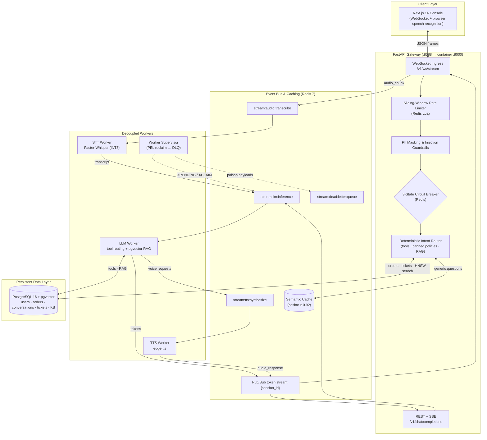

<div align="center">

# Voxa: Real-Time Voice AI Customer Support Platform
### Streaming, Fault-Tolerant, Distributed Voice & RAG Support Gateway

[](https://python.org)
[](https://fastapi.tiangolo.com)
[](https://nextjs.org)
[](https://redis.io)
[](https://github.com/pgvector/pgvector)
[](https://docker.com)
[](https://prometheus.io)
[](LICENSE)

</div>

---

## 📌 Executive Architecture Summary

**Voxa** is a distributed, event-driven customer-support platform. Instead of HTTP-polling a monolithic bot, clients hold a full-duplex WebSocket to a FastAPI gateway; answers stream back word-by-word, while slow work (speech-to-text, answer generation, speech synthesis) is decoupled into independently scalable workers connected by **Redis Streams consumer groups**. Knowledge retrieval uses **PostgreSQL + pgvector (HNSW)**, repeated policy questions are served from a **Redis semantic cache**, and a **Redis-backed circuit breaker**, **dead-letter queue** and **crash-recovery supervisor** keep failures contained.

### Design Targets & Reliability Parameters
| Area | What the code does | How to verify |
| :--- | :--- | :--- |
| **Time-to-First-Token** | Target `<180ms`. Every answer carries a measured `ttft_ms`; text queries are routed in-process by the gateway. | Telemetry HUD in the console, `/v1/admin/metrics`, `llm_time_to_first_token_seconds` |
| **Concurrency** | Async WebSocket gateway; `tests/load_test_websockets.js` ramps to 500 concurrent sockets. | Run the k6 script (no benchmark results are committed) |
| **Semantic cache** | Generic policy answers are cached with their embedding; a new query hits when cosine similarity `≥ 0.92`. Order/ticket answers are never cached. | Cache-hit badge per message, live hit ratio in the admin console |
| **Speech-to-text** | Faster-Whisper on CTranslate2 with `compute_type="int8"` on CPU. | `voxa-backend/workers/stt_worker.py` |
| **Resilience** | Circuit breaker trips at `≥50%` failures (min. 4 calls in a 10s window), probes again after 15s; tasks are dead-lettered after 3 attempts. | `tests/test_regressions.py`, `tests/test_e2e_stack.py` |

---

## 🏛️ System Architecture



---

## 🛠️ Core Engineering Highlights

### 1. Streaming Ingress & Worker Pipeline
* **Full-duplex WebSocket (`/v1/ws/stream`):** JSON `text_query` / `audio_chunk` frames in; `token_chunk`, `ack`, `audio_response` and `error` frames out. Text queries are answered by the gateway's priority-ordered intent router and streamed word-by-word, each frame carrying `ttft_ms` and a `trace_id`.
* **Voice path:** `audio_chunk` (base64 audio) → `stream:audio:transcribe` → STT worker (Faster-Whisper INT8, inference off the event loop) → `stream:llm:inference` → LLM worker → tokens on Redis Pub/Sub, plus `stream:tts:synthesize` → TTS worker → `audio_response`. The bundled web console uses the browser's speech recognition for microphone input, so this server-side path is exercised by API clients.
* **REST SSE (`POST /v1/chat/completions`):** dispatches the prompt to the LLM worker over Redis Streams and relays its Pub/Sub tokens as Server-Sent Events; times out to a fallback after `LLM_RESPONSE_TIMEOUT_SEC` and feeds the circuit breaker.

### 2. RAG & Redis Semantic Vector Cache
* **Tier 1 (Redis semantic cache):** generic questions are embedded with `sentence-transformers/all-MiniLM-L6-v2` (384-d, normalised) and compared against cached embeddings by dot product; `≥ 0.92` returns the cached answer. Lookups use bounded `SCAN` + one `MGET` (never `KEYS`).
* **Tier 2 (pgvector):** cache misses run an HNSW cosine search (`<=>`, `vector_cosine_ops`) over the knowledge base.
* **Isolation:** order lookups, refund checks and escalation tickets are user-specific or side-effecting, so they never read from or write to the shared cache.

### 3. Distributed Resilience & Fault Tolerance
* **3-state circuit breaker (Redis, shared by all replicas):**
  * `CLOSED`: success/failure outcomes are counted in a 10-second window; with at least 4 calls and a failure ratio `≥ 50%` it trips.
  * `OPEN`: requests get an immediate fallback message for 15 seconds.
  * `HALF_OPEN`: exactly one canary request is admitted via an atomic `SET NX EX` lease; success closes the breaker, failure re-opens it.
* **Retries & dead-letter queue:** workers re-enqueue a failed task with `retry_count + 1`; after 3 attempts it goes to `stream:dead:letter:queue` with the error and origin stream, and the client receives an `error` frame.
* **Crash recovery:** `worker_supervisor` scans each consumer group's Pending Entries List; entries idle for more than 15s (crashed consumer) are `XCLAIM`ed and re-enqueued, carrying the attempt count so a crash-looping payload still reaches the DLQ.
* **Rate limiting:** an atomic Lua sliding-window log in Redis, keyed by authenticated user (or client IP), default 30 requests/minute. REST endpoints return `429` + `Retry-After: 60`; WebSocket messages get an `error` frame.
* **Bounded streams:** every `XADD` uses `MAXLEN ~ 10000` so acknowledged entries do not accumulate forever.

### 4. Security
* **Guardrails:** prompt-injection phrases are neutralised and card numbers / phone numbers / SSNs are masked before text is routed, embedded, cached, persisted or sent to a worker.
* **Auth:** bcrypt password hashing (off the event loop) and signed HS256 JWTs. There is no hard-coded signing key: set `JWT_SECRET_KEY`, otherwise each process generates a random one.
* **Authorization:** admin endpoints require the `admin` role; conversations and feedback are ownership-checked; agent-tool endpoints require authentication.
* **Input bounds:** WebSocket text (2,000 chars) and audio (4 MB base64) payloads are size-limited; malformed or unknown frames get an `error` reply instead of closing the session.
* **Containers:** Python images run as uid `1001`, the frontend as the `node` user; `.dockerignore` keeps `.env` files out of images.

### 5. Telemetry & Observability
* **Prometheus (`/metrics`):** `http_request_duration_seconds` (labelled by route template, not raw path), `llm_time_to_first_token_seconds`, `websocket_active_connections`, `semantic_cache_hit_total`, `semantic_cache_miss_total`.
* **Admin console (`/admin`, admin login):** average TTFT, p95 end-to-end latency (`percentile_cont`), cache hit ratio, live worker heartbeats, queue backlog (pending + lag from `XINFO GROUPS`), open WebSockets, and the latest escalation tickets, refreshed every 10s.
* **Telemetry HUD:** per-answer TTFT, stream throughput, end-to-end latency, circuit-breaker state and correlation `trace_id`.

---

## 📂 Repository Structure

```
voxa-voice-customer-support/
├── voxa-backend/                       # FastAPI gateway + Redis Streams workers
│   ├── app/
│   │   ├── main.py                     # REST/SSE routes, WebSocket ingress, intent router, admin metrics
│   │   ├── config.py                   # Environment-driven settings (pydantic-settings)
│   │   ├── auth.py                     # bcrypt + JWT auth, guest accounts, role checks
│   │   ├── guardrails.py               # PII masking & prompt-injection neutralisation
│   │   ├── rate_limiter.py             # Redis Lua sliding-window limiter + idempotency keys
│   │   ├── circuit_breaker.py          # Distributed 3-state circuit breaker
│   │   ├── rag_engine.py               # Semantic cache (Redis) + pgvector HNSW retrieval
│   │   ├── agent_tools.py              # Order lookup, refund eligibility, escalation, intent detection
│   │   ├── queue_manager.py            # Redis Streams producer & consumer-group bootstrap
│   │   ├── telemetry.py                # Prometheus metrics & correlation-ID middleware
│   │   ├── database.py / models.py     # Async SQLAlchemy engine, ORM models, schema bootstrap
│   │   ├── schemas.py                  # Pydantic API contracts
│   │   └── seed_data.py                # Idempotent demo users, orders and knowledge base
│   ├── workers/
│   │   ├── stt_worker.py               # Faster-Whisper INT8 transcription consumer
│   │   ├── llm_worker.py               # Tool routing + pgvector RAG answer worker
│   │   ├── tts_worker.py               # edge-tts synthesis consumer
│   │   └── worker_supervisor.py        # PEL crash recovery & DLQ routing
│   ├── tests/                          # pytest suite (unit, regression, opt-in end-to-end) + k6 script
│   ├── k8s/                            # Kubernetes manifests (gateway, workers, HPA, Postgres, Redis)
│   ├── telemetry/prometheus.yml        # Prometheus scrape config
│   ├── Dockerfile.gateway / Dockerfile.worker
│   └── requirements.txt / requirements-gateway.txt
│
├── voxa-frontend/                      # Next.js 14 App Router frontend
│   ├── app/page.tsx                    # Landing page (guest session + gateway health)
│   ├── app/chat/page.tsx               # Support console: streaming chat, voice input, telemetry HUD
│   ├── app/admin/page.tsx              # Operations console (admin sign-in, live metrics, tickets)
│   ├── components/                     # VoiceOrb, AudioWaveform, TelemetryHUD, RichText
│   └── Dockerfile                      # Multi-stage production build
│
├── docs/ARCHITECTURE.md, docs/RUNBOOK.md
├── backend.py, frontend.py, model.ipynb  # V1 prototype (historical, see below)
├── PROJECT_HANDBOOK.html               # Self-contained architecture & interview handbook
├── docker-compose.yml                  # Full local stack
└── README.md
```

---

## 📖 Interactive Architecture & SDE-1 Interview Handbook

The repository includes a comprehensive, offline-first interactive engineering handbook in [`PROJECT_HANDBOOK.html`](PROJECT_HANDBOOK.html):
* **Rosetta Stone & Technical Reality Summary:** Line-by-line verification between high-level architectural claims and actual implementation code.
* **10-Point Production Engineering Audit:** Code-evidenced solutions for distributed circuit breaker probe-gating, pgvector HNSW indexing, bounded Redis cache scanning, and stream crash recovery.
* **Senior MAANG Interview Defense (64+ Questions):** Deep technical responses covering distributed systems, race conditions, vector databases, and concurrency control.

---

## 🚀 Quickstart & Deployment

### Prerequisites
* **Docker Engine** `v24.0+` & **Docker Compose** `v2.20+`
* *(Optional for running on the host)* Python 3.11+, Node.js 20+, PostgreSQL 16 with pgvector, Redis 7+

### 1. Clone & Configure Environment
```bash
git clone https://github.com/pratyushkandari/voxa-voice-customer-support.git
cd voxa-voice-customer-support
```

Optionally create a root `.env` file; Docker Compose substitutes these values:
```env
# Stable JWT signing key (unset => a random key per gateway start; tokens then expire on restart)
JWT_SECRET_KEY=<output of: openssl rand -hex 32>
# Password of the seeded admin@voxa.ai account (used to sign in to /admin)
SEED_ADMIN_PASSWORD=adminpassword123
# Only when serving on a non-localhost host, e.g. a cloud VM at 203.0.113.10:
NEXT_PUBLIC_API_URL=http://203.0.113.10:8088
CORS_ALLOW_ORIGIN_REGEX=^https?://203\.0\.113\.10(:[0-9]+)?$
```
`NEXT_PUBLIC_API_URL` is baked into the frontend at **build** time, so rebuild the frontend (`docker compose build frontend`) after changing it. Every backend setting (rate limit, model names, timeouts, stream names) is documented in [`voxa-backend/.env.example`](voxa-backend/.env.example).

### 2. Start All Services via Docker Compose
```bash
docker compose up --build -d
```
The first start downloads the embedding and Whisper models into the containers; the TTS worker needs outbound internet access for edge-tts.

### 3. Verify System Health
| Service | Endpoint | Description |
| :--- | :--- | :--- |
| **Frontend UI** | `http://localhost:3000` | Landing page → support console |
| **Operations Console** | `http://localhost:3000/admin` | Sign in as `admin@voxa.ai` (`SEED_ADMIN_PASSWORD`) |
| **FastAPI Gateway** | `http://localhost:8088/health` | Liveness probe (`/docs` for the OpenAPI UI) |
| **Prometheus Metrics**| `http://localhost:8088/metrics` | Raw Prometheus exposition |
| **Prometheus** | `http://localhost:9090` | Scrapes the gateway every 5s |
| **Grafana** | `http://localhost:3001` | Empty Grafana instance (add Prometheus as a data source; no dashboards are provisioned) |

Seeded demo data: orders `ORD-88412` (shipped), `ORD-10294` (outside the refund window), `ORD-99120` (processing), plus a demo user `demo@voxa.ai` / `demopassword123`.

---

## 🧪 Testing & Verification

### Backend unit & regression tests (hermetic: no Redis, PostgreSQL or model downloads)
```bash
cd voxa-backend
pip install -r requirements.txt
pytest -v
```
`tests/conftest.py` swaps the embedding model for a deterministic test double; `tests/test_regressions.py` pins every defect fixed in the latest audit.

### End-to-end tests against a running stack
```bash
docker compose up -d                      # from the repository root
cd voxa-backend
VOXA_E2E_BASE_URL=http://localhost:8088 pytest tests/test_e2e_stack.py -v
```
These drive the real gateway, PostgreSQL/pgvector, Redis and LLM worker: WebSocket intents, semantic-cache hits, persistence, admin metrics, SSE through the worker, ownership checks and rate limiting.

### Frontend
```bash
cd voxa-frontend
npm ci
npm run lint && npm run typecheck && npm run build
```

### Load testing the WebSocket ingress (k6)
```bash
k6 run -e WS_URL=ws://localhost:8088/v1/ws/stream voxa-backend/tests/load_test_websockets.js
```
Raise `RATE_LIMIT_REQUESTS_PER_MINUTE` on the gateway under test first: all virtual users share one client IP.

---

## 🏛️ Architecture Decision Records (ADRs)

### ADR-001: Task Transport — Redis Streams vs. Apache Kafka
* **Context:** Real-time voice inference demands low-latency task dispatch to inference workers with minimal broker overhead.
* **Decision:** Selected **Redis Streams** with consumer groups over Apache Kafka.
* **Trade-off Analysis:** Kafka offers durable multi-day log retention and replay, but adds a JVM cluster and operational weight that a single interactive workload does not need. Redis Streams gives consumer-group delivery (`XREADGROUP`), explicit acknowledgment (`XACK`) and a pending-entries list for crash recovery (`XPENDING`/`XCLAIM`), while the same Redis also serves the cache, rate limiter, circuit breaker and Pub/Sub. The cost is weaker durability: streams are memory-bound (hence `MAXLEN`) and depend on Redis persistence settings.

### ADR-002: Vector Search & ACID Relational Storage — PostgreSQL (pgvector) vs. Standalone Vector DBs
* **Context:** The platform requires relational customer data (orders, conversations, support tickets) combined with 384-dimensional semantic knowledge embeddings.
* **Decision:** Selected **PostgreSQL 16 with `pgvector`** over external vector databases (Pinecone, Chroma, Milvus).
* **Trade-off Analysis:** External vector engines introduce dual writes, cross-system consistency problems and extra network hops. PostgreSQL with `pgvector` keeps relational queries and cosine-distance search (`<=>`, HNSW index) in one transactional store, simplifying backups and connection pooling, at the cost of the scale ceilings of a single Postgres primary.

### ADR-003: Model Execution Runtime — CTranslate2 Faster-Whisper INT8 vs. Vanilla PyTorch
* **Context:** Speech-to-text must run on commodity CPU instances without dedicated GPUs.
* **Decision:** Deployed **Faster-Whisper running on CTranslate2 with INT8 quantization**.
* **Trade-off Analysis:** INT8 weights substantially reduce memory and CPU time compared with FP32 PyTorch Whisper, with a small accuracy cost that is acceptable for short support utterances. Accuracy and latency for this deployment have not been benchmarked in this repository.

### ADR-004: Ingress Concurrency — Full-Duplex WebSockets vs. HTTP Polling / SSE
* **Context:** Continuous bidirectional interaction: user audio/text in, streamed tokens and audio out.
* **Decision:** Full-duplex **WebSocket transport** for the console; Server-Sent Events kept for simple request/response API clients.
* **Trade-off Analysis:** Polling adds connection overhead and latency. A persistent WebSocket carries both directions on one connection; worker results reach the right socket through a per-session Redis Pub/Sub channel, so any gateway replica can serve the session's ingress while workers scale independently.

---

## 💥 Chaos Engineering & Failure Recovery

| Failure Scenario | Detection Mechanism | Automated Recovery Strategy | Client Impact |
| :--- | :--- | :--- | :--- |
| **Worker Crash Mid-Task** | Supervisor sees an entry idle `> 15s` in the consumer group's PEL (`XPENDING`) | `XCLAIM` + re-enqueue with an incremented attempt count; any live worker picks it up | Answer delayed by ~15–20s |
| **Poison Payload** | Task has used 3 attempts (worker retry counter or supervisor attempt count) | Moved to `stream:dead:letter:queue` with error and origin stream | Client receives an `error` frame |
| **LLM Worker / Database Outage** | REST worker timeouts or router exceptions recorded by the circuit breaker | Breaker opens (≥50% failures), returns a fallback for 15s, then admits one canary probe | Fallback message instead of a hang |
| **Traffic Spike** | Redis sliding-window log per user / IP | `429 Too Many Requests` + `Retry-After: 60` (REST) or an `error` frame (WebSocket) | Excess requests rejected early |

---

## ⚠️ Known Limitations
* **No generative LLM yet:** the LLM worker answers with deterministic tool routing and pgvector retrieval. `LLM_MODEL_NAME` (Qwen2.5-0.5B-Instruct) names the intended model but nothing loads it.
* **Web console voice:** microphone input uses the browser's Web Speech API (Chrome, Edge, Safari); the console does not yet send `audio_chunk` frames or play `audio_response` audio from the TTS worker.
* **Observability:** Grafana ships without dashboards; circuit-breaker state lives in Redis (`circuit:ai_worker:state`) rather than a Prometheus metric.
* **Frontend framework:** pinned to the latest Next.js 14.2 patch. Some Next.js advisories are only fixed in 15.5+/16, which is a major upgrade.

---

## 📜 Architectural Evolution (V1 Prototype ➔ V2 Distributed Mesh)
This repository documents the evolution of Voxa from an early exploratory prototype to a distributed platform:
* **V1 Prototype (`backend.py`, `frontend.py`, `model.ipynb`):** Monolithic Flask + Streamlit prototype evaluating a fine-tuned FLAN-T5 seq2seq model and local PyAudio recordings. Its dependencies are listed in the root `requirements.txt`.
* **V2 Distributed Mesh (`voxa-backend/`, `voxa-frontend/`, `docker-compose.yml`):** Decoupled asynchronous services powered by FastAPI WebSockets, Redis Streams, PostgreSQL pgvector RAG, Faster-Whisper INT8, edge-tts, and Next.js 14.

---

## 📄 License
Distributed under the **MIT License**. See [`LICENSE`](LICENSE) for details.

---

<div align="center">
<sub>Engineered by <b>Pratyush Kandari</b> • Distributed Voice & Real-Time AI Systems</sub>
</div>
