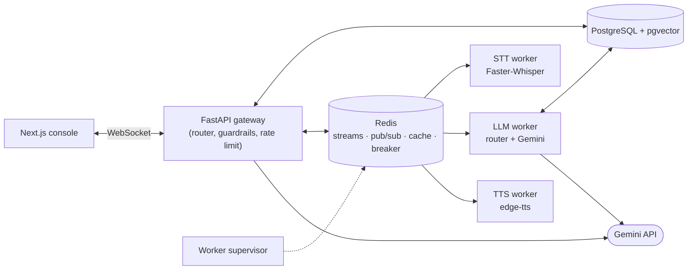

# Voxa

A real-time customer-support platform with streaming voice and text chat.

The web console holds a WebSocket to a FastAPI gateway. Typed questions are answered by the gateway. Spoken questions go through workers connected by Redis Streams: Faster-Whisper turns the recording into text, the LLM worker answers it, and edge-tts speaks the reply. Each worker can be scaled and restarted on its own.

Every answer is built in two steps:

1. An intent router decides what data the question needs and fetches it:
   - order status and refund eligibility from PostgreSQL, visible to the order's owner only
   - a support ticket for complaints and requests for a person
   - the closest help-centre articles from a pgvector knowledge base
2. Gemini 3.6 Flash writes a short reply from those facts only.

If Gemini isn't configured, fails, times out or runs out of quota, the router's plain reply, built from the same facts, is sent instead.

**Stack:** Python 3.11, FastAPI, Redis 7, PostgreSQL 16 + pgvector, sentence-transformers (all-MiniLM-L6-v2), Gemini (google-genai), Faster-Whisper, edge-tts, Next.js 14, Docker Compose, Prometheus.

## Features

- **Streaming chat over WebSocket.** Gemini's reply is relayed as it arrives, with time to first token, cache-hit and fallback flags, and a trace ID on every answer.
- **Voice in the console.** The browser records a clip and sends it to the gateway. Faster-Whisper (int8, CPU) transcribes it, the reply streams back as text, and edge-tts audio is played when it's ready.
- **Grounded replies:**
  - code picks the facts, and Gemini only words them
  - Gemini never sees another customer's order
  - PII is masked before anything is stored or sent
- **Retrieval:**
  - HNSW search over the knowledge base in pgvector
  - a Redis semantic cache (cosine ≥ 0.92) for knowledge answers that Gemini wrote
- **Reliability:**
  - a Redis-backed circuit breaker around Gemini, with plain fallback replies
  - worker retries and a dead-letter queue
  - a supervisor that reclaims work from crashed workers
- **Security:**
  - prompt-injection checks before routing
  - bcrypt + JWT auth, and per-user / per-IP rate limiting
- **Operations console:** live TTFT, p95 latency, cache hit ratio, worker heartbeats, queue backlog and escalation tickets. Prometheus scrapes the gateway and the LLM worker.

## Architecture



**Typed questions** never leave the gateway:

1. Rate limit and mask PII.
2. Route the question and fetch the facts (`app/agent_tools.py`).
3. Gemini writes the reply, which streams back as it arrives (`app/llm.py`).
4. Save the exchange for signed-in users.

**Spoken questions** go through Redis Streams:

1. The STT worker transcribes the clip and publishes the transcript.
2. The LLM worker answers it the same way as a typed question.
3. The TTS worker turns the reply into MP3 audio.

Worker events come back on a per-session Pub/Sub channel, which the gateway relays to the socket. Any gateway replica can serve any session.

See [docs/ARCHITECTURE.md](docs/ARCHITECTURE.md) for the wire protocol, delivery guarantees and the circuit-breaker state machine.

## Getting started

### Prerequisites

- Docker Engine 24+ with Compose v2.20+
- A Gemini API key from [Google AI Studio](https://aistudio.google.com/apikey). It's optional: without one, every reply is the plain fallback.
- Optional, to run services outside Docker: Python 3.11+, Node.js 20+, PostgreSQL 16 with pgvector, Redis 7+

### Run

```bash
git clone https://github.com/pratyushkandari/voxa-voice-customer-support.git
cd voxa-voice-customer-support
echo "GEMINI_API_KEY=<your key>" > .env
docker compose up --build -d
```

On first start the containers download the embedding and Whisper models. The TTS worker needs outbound internet access, because edge-tts uses Microsoft's online voices.

| Service | URL |
| --- | --- |
| Web console | http://localhost:3000 |
| Admin console | http://localhost:3000/admin (sign in as `admin@voxa.ai`) |
| Gateway health / OpenAPI | http://localhost:8088/health, http://localhost:8088/docs |
| Prometheus | http://127.0.0.1:9090 |

PostgreSQL, Redis and Prometheus only listen on `127.0.0.1`. On a remote VM, use an SSH tunnel, e.g. `ssh -L 9090:127.0.0.1:9090 user@vm`.

**Demo data**

- Orders `ORD-88412` (shipped), `ORD-10294` (outside the 30-day refund window) and `ORD-99120` (processing).
- A demo user: `demo@voxa.ai` / `demopassword123`.

### Configuration

Compose reads overrides from a `.env` file in the repository root:

| Variable | Default | Notes |
| --- | --- | --- |
| `GEMINI_API_KEY` | empty | Without it, every reply is the router's plain fallback. |
| `GEMINI_MODEL` | `gemini-3.6-flash` | Any Gemini model that supports streaming. |
| `JWT_SECRET_KEY` | random per start | Set a fixed value (`openssl rand -hex 32`), or tokens stop working after every restart. |
| `SEED_ADMIN_PASSWORD` | `adminpassword123` | Only used when the admin user is first created. |
| `POSTGRES_PASSWORD` | `postgres` | Only used when the database volume is first created. Use URL-safe characters. |
| `NEXT_PUBLIC_API_URL` | `http://localhost:8088` | Gateway URL as the browser sees it. Baked in at build time, so rebuild the frontend after changing it. |
| `NEXT_PUBLIC_WS_URL` | derived from the API URL | Only needed if the WebSocket is served elsewhere. |
| `CORS_ALLOW_ORIGIN_REGEX` | any `localhost` / `127.0.0.1` port | Browser origins allowed to call the API. |

Backend settings (rate limits, size limits, model names, stream names) are listed in [voxa-backend/.env.example](voxa-backend/.env.example).

When serving on a public IP, set `NEXT_PUBLIC_API_URL` and `CORS_ALLOW_ORIGIN_REGEX` to that host. Browsers only allow microphone access over HTTPS or on `localhost`, so voice input on a plain-HTTP public address needs TLS in front of it.

## API

Interactive docs are at `/docs` on the gateway.

| Endpoint | Auth | Description |
| --- | --- | --- |
| `GET /health` | – | Liveness probe (doesn't check Redis or PostgreSQL) |
| `GET /metrics` | – | Prometheus metrics |
| `POST /v1/auth/signup` | rate-limited | `{email, password}` → `{access_token, token_type, user}` |
| `POST /v1/auth/login` | rate-limited | `{email, password}` → `{access_token, token_type, user}` |
| `POST /v1/auth/guest-demo` | rate-limited | Creates a temporary guest account and returns its token |
| `WS /v1/ws/stream?token=<JWT>` | optional | Text and voice chat; only signed-in sessions are saved |
| `GET /v1/admin/metrics` | admin | Operational snapshot used by the admin console |
| `GET /v1/admin/tickets` | admin | Latest 20 escalation tickets |

Rate-limited endpoints return `429` with `Retry-After: 60`. The default limit is 30 requests a minute per user, or per IP for anonymous calls. The same limit applies to WebSocket messages, which get an `error` frame instead.

## Testing

**Backend unit tests.** These are self-contained: no Redis, PostgreSQL, Gemini or model downloads.

```bash
cd voxa-backend
pip install -r requirements.txt
pytest
```

- `tests/conftest.py` swaps the embedding model for a small deterministic stand-in, and stubs Faster-Whisper and edge-tts when they aren't installed.
- `tests/test_llm.py` replaces the Gemini call with a stub. It covers:
  - replies built from the router's facts
  - fallbacks on errors, timeouts and quota errors
  - the breaker opening after repeated failures
  - PII masking before the call
  - owner-only orders
  - what gets cached

**End-to-end tests against a running stack.** These cover:
- WebSocket intents and validation
- the semantic cache
- persistence and the admin API
- a voice round trip (WAV → transcript → reply → MP3)
- rate limiting

They pass with or without `GEMINI_API_KEY`. The checks look for the facts Gemini is told to repeat exactly, such as IDs and tracking numbers.

```bash
docker compose up -d
cd voxa-backend
VOXA_E2E_BASE_URL=http://localhost:8088 pytest tests/test_e2e_stack.py -v
```

Set `VOXA_E2E_ADMIN_PASSWORD` if you changed `SEED_ADMIN_PASSWORD`.

**Frontend:**

```bash
cd voxa-frontend
npm ci
npm run lint && npm run typecheck && npm run build
```

**Load test.** Raise `RATE_LIMIT_REQUESTS_PER_MINUTE` on the gateway first, because every virtual user comes from the same IP. With a Gemini key, each message is also a Gemini call against your quota.

```bash
k6 run -e WS_URL=ws://localhost:8088/v1/ws/stream voxa-backend/tests/load_test_websockets.js
```

## Project layout

```
voxa-backend/
  app/
    main.py              auth and admin routes, WebSocket handler
    agent_tools.py       intent router and the order, refund and escalation tools
    llm.py               Gemini reply writer, fallback and circuit breaker use
    rag_engine.py        semantic cache (Redis) and pgvector search
    circuit_breaker.py   Redis-backed three-state breaker
    rate_limiter.py      sliding-window limiter (Lua) and idempotency keys
    guardrails.py        PII masking and prompt-injection checks
    queue_manager.py     Redis Streams producer and consumer-group setup
    auth.py              bcrypt, JWT, guest accounts, role checks
    telemetry.py         Prometheus metrics, correlation IDs, log redaction
    config.py            settings from environment variables
    database.py, models.py, schemas.py, seed_data.py
  workers/               STT, LLM, TTS workers and the supervisor
  tests/                 pytest suite, voice fixture and k6 script
  telemetry/             Prometheus scrape config
voxa-frontend/
  app/                   landing page, chat console, admin console
  components/            voice orb, waveform, telemetry panel, text rendering
docs/                    architecture and operations runbook
docker-compose.yml
```

## Design notes

- **Code picks the facts; Gemini only writes the reply.** The router fetches data with the owner checks applied, so access control never depends on what the model decides, and the model can't be talked into reading someone else's order. The cost is flexibility: Gemini can't look anything up the router didn't fetch, so a question the router misreads gets a less useful answer.
- **A plain reply as the fallback.** The router builds a complete answer from the same facts, so a Gemini outage, timeout or exhausted free quota makes answers terser, not wrong or missing. The circuit breaker stops calling Gemini while it keeps failing.
- **Only Gemini-written knowledge answers are cached.** The cache exists to save Gemini calls. Order and ticket replies are user-specific, and a cached fallback would keep being served after Gemini recovers.
- **Speech-to-text on the server.** Recordings go through Faster-Whisper on the STT worker rather than the browser's speech API. That works in every browser, keeps audio off third-party speech services, and uses the same pipeline and limits as any other client. The cost is that there are no live captions while speaking: the transcript appears after the clip is sent.
- **Redis Streams instead of Kafka.** Consumer groups, explicit acks and the pending-entries list give at-least-once delivery and crash recovery. The same Redis also handles caching, rate limiting, the breaker and Pub/Sub, so there's one fewer system to run. The trade-off is weaker durability: streams are capped with `MAXLEN` and depend on Redis persistence.
- **pgvector instead of a separate vector database.** Orders, conversations and embeddings live in one transactional store, so there are no dual writes and only one thing to back up. The cost is the scaling ceiling of a single Postgres primary.

## Failure handling

| Failure | What happens | What the user sees |
| --- | --- | --- |
| Gemini error, timeout (10 s) or quota exhausted | The plain reply is sent. At ≥ 50% failures (with ≥ 4 calls) in 10 s the breaker opens and skips Gemini for 15 s, then lets one probe through. | A shorter plain reply with a "Fallback" badge |
| Gemini stream breaks midway | The plain reply is appended to the partial text | A complete answer |
| Worker crashes mid-task | The supervisor finds entries idle for over 15 s, claims them and re-queues them | Answer delayed by about 15–20 s |
| Task keeps failing | Moved to the dead-letter queue after 3 attempts | An `error` frame |
| PostgreSQL down | The router can't fetch facts | An `error` frame asking to try again |
| Redis down | Breaker and rate limiter let requests through and log; cache lookups count as misses | Typed chat keeps working; voice gets an `error` frame |
| Traffic spike | Per-user / per-IP sliding window | `429` on REST, an `error` frame on the WebSocket |

## Known limitations

- **Gemini free tier.** On 2026-10-28 the API limited `gemini-3.6-flash` free-tier keys to 5 requests a minute and 20 a day. Past that, replies fall back until the quota resets; the semantic cache helps with repeated questions. Google may also use free-tier prompts to improve its products. PII is masked before the call and the demo data is fictional, but use a paid key for real traffic.
- **Latency.** Measured locally with `gemini-3.6-flash` at thinking level low:
  - Gemini replies: time to first token was 2.4–5.7 s, with one 10.5 s outlier in direct API calls. Replies are short, so most of that is time to first token.
  - Semantic cache hits: about 0.2 s.
  - Fallback replies: a few milliseconds.
- **Spoken order IDs.** Whisper sometimes mishears "ORD" (as "or D", say). The reply then has no order facts and asks for the order ID.
- **Voice needs HTTPS** outside `localhost`, because browsers only allow the microphone in secure contexts.
- **Schema changes.** Tables are created with `create_all` at start-up, and there are no migrations.
- **Monitoring.** Prometheus has no dashboards or alert rules yet, and the breaker state lives in Redis rather than in a metric.
- **Next.js advisories.** The frontend is on the latest Next.js 14.2 patch; some advisories are only fixed in 15.5+/16.

## License

[MIT](LICENSE)
