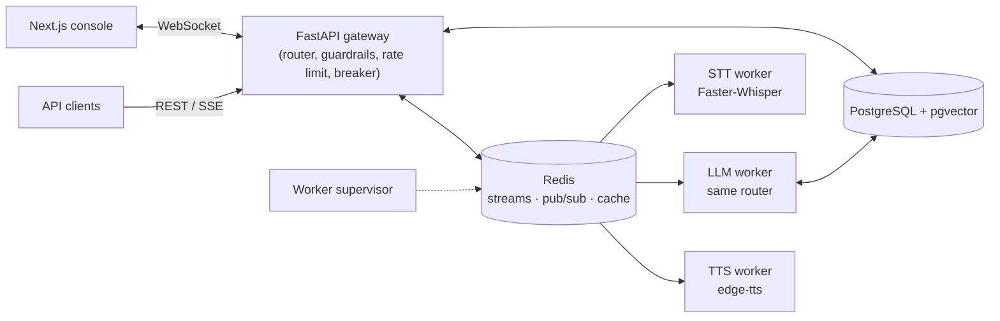

# Voxa

A real-time customer-support platform with streaming voice and text chat.

The web console holds a WebSocket to a FastAPI gateway and gets answers back word by word. Speech-to-text, answering for API clients and text-to-speech run as separate workers connected through Redis Streams, so each can be scaled and restarted on its own.

Answers come from a deterministic intent router that can:

- look up orders and refund eligibility in PostgreSQL
- open support tickets
- reply with canned policies
- fall back to semantic search over a pgvector knowledge base, with a Redis semantic cache in front

There is no generative model.

**Stack:** Python 3.11, FastAPI, Redis 7, PostgreSQL 16 + pgvector, sentence-transformers, Faster-Whisper, edge-tts, Next.js 14, Docker Compose, Prometheus.

## Features

- **Streaming chat over WebSocket**, with per-answer time-to-first-token, cache-hit flag and trace ID.
- **Voice pipeline for API clients:** audio → Faster-Whisper (int8, CPU) → answer → edge-tts audio, all over Redis Streams.
- **REST + Server-Sent Events** endpoint for clients that don't want a socket.
- **Retrieval:**
  - a Redis semantic cache: cosine ≥ 0.92, generic questions only
  - an HNSW search over the knowledge base in pgvector
- **Reliability:**
  - a Redis-backed three-state circuit breaker shared by all gateway replicas
  - worker retries and a dead-letter queue
  - a supervisor that reclaims work from crashed workers
- **Security:**
  - PII masking and prompt-injection checks before any text is stored or routed
  - bcrypt + JWT auth, and per-user / per-IP rate limiting
  - owner-only order lookups
- **Operations console:** live TTFT, p95 latency, cache hit ratio, worker heartbeats, queue backlog and escalation tickets. Prometheus metrics come from the gateway.

## Architecture



**Typed questions from the console** never leave the gateway:

1. Rate limit.
2. Mask PII.
3. Check the circuit breaker.
4. Run the router (`app/agent_tools.py`), which reads orders and tickets from PostgreSQL and answers generic questions from the cache or the knowledge base.
5. Stream the answer back.

**REST prompts and audio** go through Redis Streams:

1. The STT worker transcribes the audio.
2. The LLM worker runs the same router.
3. Tokens come back on a per-session Pub/Sub channel, which the gateway relays to the client.

Any gateway replica can serve any session.

See [docs/ARCHITECTURE.md](docs/ARCHITECTURE.md) for the wire protocol, delivery guarantees and the circuit-breaker state machine.

## Getting started

### Prerequisites

- Docker Engine 24+ with Compose v2.20+
- Optional, to run services outside Docker: Python 3.11+, Node.js 20+, PostgreSQL 16 with pgvector, Redis 7+

### Run

```bash
git clone https://github.com/pratyushkandari/voxa-voice-customer-support.git
cd voxa-voice-customer-support
docker compose up --build -d
```

On first start the containers download the embedding and Whisper models. The TTS worker needs outbound internet access, because edge-tts uses Microsoft's online voices.

| Service | URL |
| --- | --- |
| Web console | http://localhost:3000 |
| Admin console | http://localhost:3000/admin (sign in as `admin@voxa.ai`) |
| Gateway health / OpenAPI | http://localhost:8088/health, http://localhost:8088/docs |
| Prometheus | http://127.0.0.1:9090 |
| Grafana | http://127.0.0.1:3001 (no dashboards provisioned) |

PostgreSQL, Redis, Prometheus and Grafana only listen on `127.0.0.1`. On a remote VM, use an SSH tunnel, e.g. `ssh -L 3001:127.0.0.1:3001 user@vm`.

**Demo data**

- Orders `ORD-88412` (shipped), `ORD-10294` (outside the 30-day refund window) and `ORD-99120` (processing).
- A demo user: `demo@voxa.ai` / `demopassword123`.

### Configuration

Compose reads overrides from a `.env` file in the repository root:

| Variable | Default | Notes |
| --- | --- | --- |
| `JWT_SECRET_KEY` | random per start | Set a fixed value (`openssl rand -hex 32`), or tokens stop working after every restart. |
| `SEED_ADMIN_PASSWORD` | `adminpassword123` | Only used when the admin user is first created. |
| `POSTGRES_PASSWORD` | `postgres` | Only used when the database volume is first created. Use URL-safe characters. |
| `GRAFANA_ADMIN_PASSWORD` | `admin` | |
| `NEXT_PUBLIC_API_URL` | `http://localhost:8088` | Gateway URL as the browser sees it. Baked in at build time, so rebuild the frontend after changing it. |
| `NEXT_PUBLIC_WS_URL` | derived from the API URL | Only needed if the WebSocket is served elsewhere. |
| `CORS_ALLOW_ORIGIN_REGEX` | any `localhost` / `127.0.0.1` port | Browser origins allowed to call the API. |

Backend settings (rate limits, timeouts, model names, stream names) are listed in [voxa-backend/.env.example](voxa-backend/.env.example).

When serving on a public IP, set `NEXT_PUBLIC_API_URL` and `CORS_ALLOW_ORIGIN_REGEX` to that host. Browsers only allow microphone access over HTTPS or on `localhost`, so voice input on a plain-HTTP public address needs TLS in front of it.

## API

Interactive docs are at `/docs` on the gateway.

| Endpoint | Auth | Description |
| --- | --- | --- |
| `GET /health` | – | Liveness probe (doesn't check Redis or PostgreSQL) |
| `GET /metrics` | – | Prometheus metrics |
| `POST /v1/auth/signup` | rate-limited | `{email, password}` → `{access_token, token_type, user}` |
| `POST /v1/auth/login` | rate-limited | `{email, password}` → `{access_token, token_type, user}` |
| `POST /v1/auth/guest-demo` | rate-limited | Creates a temporary guest account and returns its token |
| `POST /v1/chat/completions` | Bearer | SSE answer for `{message, conversation_id?}` |
| `WS /v1/ws/stream?token=<JWT>` | optional | Streaming chat; only signed-in sessions are saved |
| `GET /v1/tools/order/{order_id}` | Bearer | Order status (owner only) |
| `GET /v1/tools/refund/{order_id}` | Bearer | Refund eligibility (owner only) |
| `POST /v1/tools/escalate` | Bearer | Opens a ticket (`issue_summary`, `priority` as query params) |
| `POST /v1/feedback` | Bearer | Rates one of your assistant messages, `{message_id, score, feedback_text?}` |
| `GET /v1/admin/metrics` | admin | Operational snapshot used by the admin console |
| `GET /v1/admin/tickets` | admin | Latest 20 escalation tickets |

Rate-limited endpoints return `429` with `Retry-After: 60`. The default limit is 30 requests a minute per user, or per IP for anonymous calls. They also accept an optional `X-Idempotency-Key` header: a repeat within 60 s gets `409`.

## Testing

**Backend unit and regression tests.** These are self-contained: no Redis, PostgreSQL or model downloads.

```bash
cd voxa-backend
pip install -r requirements.txt
pytest
```

`tests/conftest.py` swaps the embedding model for a small deterministic stand-in, and stubs Faster-Whisper and edge-tts when they aren't installed.

**End-to-end tests against a running stack.** These cover WebSocket intents, cache hits, persistence, the admin API, SSE through the worker, ownership checks and rate limiting:

```bash
docker compose up -d
cd voxa-backend
VOXA_E2E_BASE_URL=http://localhost:8088 pytest tests/test_e2e_stack.py -v
```

Set `VOXA_E2E_ADMIN_PASSWORD` if you changed `SEED_ADMIN_PASSWORD`.

**Frontend:**

```bash
cd voxa-frontend
npm ci
npm run lint && npm run typecheck && npm run build
```

**Load test.** Raise `RATE_LIMIT_REQUESTS_PER_MINUTE` on the gateway first: every virtual user comes from the same IP.

```bash
k6 run -e WS_URL=ws://localhost:8088/v1/ws/stream voxa-backend/tests/load_test_websockets.js
```

## Project layout

```
voxa-backend/
  app/
    main.py              REST/SSE routes, WebSocket handler, admin metrics
    agent_tools.py       intent router and the order, refund and escalation tools
    rag_engine.py        semantic cache (Redis) and pgvector search
    circuit_breaker.py   Redis-backed three-state breaker
    rate_limiter.py      sliding-window limiter (Lua) and idempotency keys
    guardrails.py        PII masking and prompt-injection checks
    queue_manager.py     Redis Streams producer and consumer-group setup
    auth.py              bcrypt, JWT, guest accounts, role checks
    telemetry.py         Prometheus metrics, correlation IDs, log redaction
    config.py            settings from environment variables
    database.py, models.py, schemas.py, seed_data.py
  workers/               STT, LLM, TTS workers and the supervisor
  tests/                 pytest suite and k6 script
  k8s/                   Kubernetes manifests
  telemetry/             Prometheus scrape config
voxa-frontend/
  app/                   landing page, chat console, admin console
  components/            voice orb, waveform, telemetry panel, text rendering
docs/                    architecture and operations runbook
docker-compose.yml
```

## Design notes

- **Redis Streams instead of Kafka.** Consumer groups, explicit acks and the pending-entries list give at-least-once delivery and crash recovery. The same Redis also handles caching, rate limiting, the breaker and Pub/Sub, so there's one fewer system to run. The trade-off is weaker durability: streams are capped with `MAXLEN` and depend on Redis persistence.
- **pgvector instead of a separate vector database.** Orders, conversations and embeddings live in one transactional store, so there are no dual writes and only one thing to back up. The cost is the scaling ceiling of a single Postgres primary.
- **Faster-Whisper with int8 weights.** It runs on commodity CPUs with much less memory than FP32 PyTorch Whisper. Accuracy and latency haven't been benchmarked here.
- **WebSocket for the console, SSE for API clients.** One persistent connection carries both directions for the console, and the per-session Pub/Sub channel lets any gateway replica deliver worker results.

## Failure handling

| Failure | What happens | What the user sees |
| --- | --- | --- |
| Worker crashes mid-task | The supervisor finds entries idle for over 15 s, claims them and re-queues them | Answer delayed by about 15–20 s |
| Task keeps failing | Moved to the dead-letter queue after 3 attempts | An `error` frame |
| LLM worker or database down | Failures trip the breaker at ≥ 50%; fallback for 15 s, then one probe request | A fallback message instead of a hang |
| Redis down | Breaker and rate limiter let requests through and log; cache lookups count as misses | Console chat keeps working; REST gets the fallback; voice gets an `error` frame |
| Traffic spike | Per-user / per-IP sliding window | `429` on REST, an `error` frame on the WebSocket |

## Known limitations

- **No generative model.** The "LLM worker" name refers to its place in the pipeline; answers come from the router and the knowledge base.
- **Console voice.** The console uses the browser's Web Speech API. It doesn't send `audio_chunk` frames or play the TTS audio; that path is for API clients.
- **Spoken order IDs.** Whisper sometimes mishears "ORD" (as "or D", say), in which case the voice answer falls back to the order-tracking policy.
- **Schema changes.** Tables are created with `create_all` at start-up, and there are no migrations.
- **Monitoring.** Grafana has no dashboards yet, and the breaker state lives in Redis rather than in a Prometheus metric.
- **Kubernetes.** The manifests under `k8s/` haven't been deployed to a cluster. They expect pre-built `voxa/gateway` and `voxa/worker` images and a `voxa-secrets` Secret.
- **Next.js advisories.** The frontend is on the latest Next.js 14.2 patch; some advisories are only fixed in 15.5+/16.

## License

[MIT](LICENSE)
