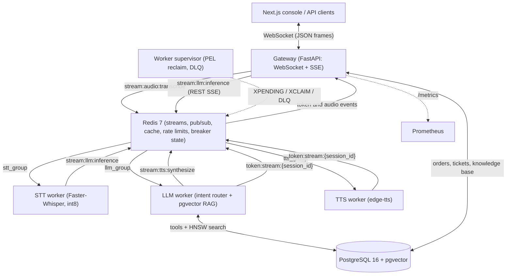
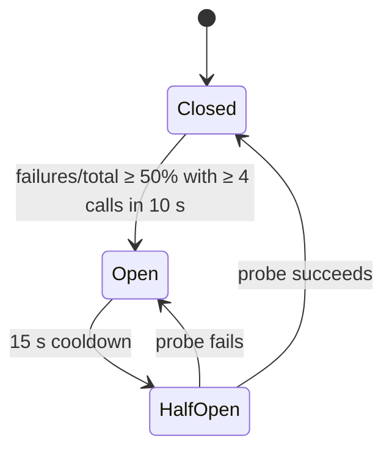

# Architecture

This document describes how Voxa's services fit together, the wire protocol between the console and the gateway, and how failures are handled. For setup and the API surface, see the [README](../README.md).

## Overview

Voxa is split into a gateway and a set of workers that talk through Redis:

- The **gateway** (FastAPI) owns client connections: a WebSocket for the web console and a REST/SSE endpoint for API clients. It answers typed questions itself.
- **Workers** handle the slow or bursty work: speech-to-text, answering REST and voice prompts, and text-to-speech. Each worker type is a Redis Streams consumer group, so it can be scaled on its own.
- Results flow back over a per-session Redis Pub/Sub channel, which means any gateway replica can deliver a worker's answer to the right client.
- **PostgreSQL with pgvector** stores users, orders, conversations, tickets and the knowledge base, including its embeddings.



The latency target is a time-to-first-token (TTFT) under 180 ms. Every answer reports its measured `ttft_ms`; no benchmark results are checked in.

## WebSocket protocol

Clients connect to `/v1/ws/stream?token=<JWT>`. The token is optional. Anonymous sessions work, but only authenticated sessions are saved (a conversation belongs to a user) and linked to the tickets they create. The token travels in the query string because browsers can't set headers on a WebSocket handshake; the gateway hides it in its access logs.

All frames are JSON text frames. A binary frame gets an `error` reply.

**Client → gateway**

- `{"type": "text_query", "text": "...", "trace_id": "<optional>"}`: at most 2,000 characters.
- `{"type": "audio_chunk", "audio_data": "<base64>", "trace_id": "<optional>"}`: one utterance, at most 4 MB of base64. Any container FFmpeg can decode works (WAV, WebM/Opus, OGG).

**Gateway → client**

- `token_chunk`: the answer, streamed a word at a time. The last frame has `is_final: true` and carries that turn's measurements:

  ```json
  {
    "type": "token_chunk",
    "token": "",
    "is_final": true,
    "ttft_ms": 6,
    "total_latency_ms": 412,
    "cache_hit": false,
    "circuit_breaker": "CLOSED",
    "trace_id": "b1a47df1-0c5a-4e89-b7b5-fb358a9ce71b"
  }
  ```

- `ack`: an `audio_chunk` was queued for transcription.
- `audio_response`: base64 MP3 from the TTS worker (voice requests only).
- `error`: a validation failure, a rate limit, an empty transcript or a dead-lettered task.

## Answer routing

Every channel answers with one function, `answer_text_query` in `app/agent_tools.py`. It checks rules in priority order and stops at the first match:

1. Prompt-injection guardrail.
2. Chargeback or legal threats: opens an urgent ticket.
3. Canned policy answers (bulk orders, customs/VAT, Bluetooth multipoint, water damage, price match, missing delivery, buying advice).
4. Order lookup or refund eligibility from PostgreSQL. `ORD-88412`, `ORD 88412` and `ORD88412` are all accepted, because speech-to-text drops the hyphen.
5. Request for a human: opens a ticket.
6. Greeting.
7. Everything else: semantic cache, then pgvector knowledge-base search.

Only step 7 reads or writes the semantic cache, because order data and tickets are user-specific.

The gateway runs the router in-process for WebSocket `text_query` frames, so there's no worker hop. The LLM worker runs the same function for REST prompts and voice transcripts.

An order that belongs to a user is visible only to that user. The seeded demo orders have no owner and are visible to everyone. Someone else's order gets the same reply as a missing one, so order IDs can't be probed.

There is no generative model. "LLM worker" names the pipeline stage, not a language model.

The web console captures speech with the browser's Web Speech API and sends the transcript as a `text_query`. The server-side `audio_chunk` → Whisper path is for API clients.

## Workers and delivery guarantees

The gateway creates these consumer groups on start-up (idempotently):

| Stream | Group | Consumer |
| --- | --- | --- |
| `stream:audio:transcribe` | `stt_group` | STT worker |
| `stream:llm:inference` | `llm_group` | LLM worker (up to 8 entries per read) |
| `stream:tts:synthesize` | `tts_group` | TTS worker |
| `stream:dead:letter:queue` | `dlq_group` | inspected manually |

Every `XADD` uses `MAXLEN ~ 10000`, so acknowledged entries don't accumulate.

Delivery is at-least-once:

- **Acknowledge last:** a worker `XACK`s an entry only after it has answered, re-queued or dead-lettered it.
- **Own pending entries first:** on each loop a worker re-reads its own unacknowledged entries (`XREADGROUP ... 0`) before taking new ones. Consumer names are random per process, so entries left by a crashed process are handled by the supervisor instead.
- **Crash recovery:** every 5 s the supervisor asks for entries idle longer than 15 s (`XPENDING ... IDLE 15000`), claims them and re-queues them with `retry_count` incremented. The attempt count travels in the payload, because a re-queued entry starts a fresh delivery counter.
- **Long tasks:** while a worker is busy (a long transcription, or entries waiting in its batch), it re-claims them every 5 s (`XCLAIM ... JUSTID`). Healthy work is therefore never mistaken for a crash and run twice.
- **Dead-letter queue:** after 3 attempts an entry goes to `stream:dead:letter:queue` with the error and its origin stream, and the client gets an `error` frame.

The LLM worker loads the embedding model before it starts consuming. Loading it lazily on the first prompt took about 20 s, as long as the gateway waits for an answer.

## Retrieval and the semantic cache

```
generic question (PII already masked)
  │
  ├─ Redis semantic cache: cosine ≥ 0.92 ──► cached answer (cache_hit = true)
  │
  └─ miss ─► pgvector HNSW search (<=>) ──► best passage if similarity > 0.35,
                                             otherwise a general policy answer
```

**Embeddings**

- `all-MiniLM-L6-v2`, 384 dimensions.
- L2-normalised, so cosine similarity is a dot product.
- Encoding runs in a thread so it never blocks the event loop.

**Cache**

- A lookup scans at most 50 keys with `SCAN` and fetches them with one `MGET`.
- Entries expire after an hour.
- Only answers that don't depend on the user are cached.

**Knowledge base**

- The `knowledge_base` table is seeded on start-up.
- It's indexed with `USING hnsw (embedding vector_cosine_ops)` (pgvector defaults: `m = 16`, `ef_construction = 64`).

## Circuit breaker

Failures on the answering path feed one Redis-backed breaker (`circuit:ai_worker:*`) shared by every gateway replica. On the WebSocket path that means router exceptions; on the SSE path, LLM-worker timeouts.



- **Closed:** traffic flows, and successes and failures are both counted.
- **Open:** callers get a fallback message immediately.
- **Half-open:** one probe request holds a 10 s `SET NX EX` lease; everyone else gets the fallback.
- **Redis unreachable:** the breaker can't read or write its state, so it lets requests through (state `UNKNOWN`) and logs a warning. The rate limiter does the same, so answers that don't need Redis keep working.

## Metrics

The gateway serves Prometheus metrics on `/metrics`:

- `http_request_duration_seconds{method,endpoint,status_code}`: labelled by route template, not raw path, to keep cardinality bounded.
- `llm_time_to_first_token_seconds`: TTFT of SSE answers relayed from the LLM worker.
- `websocket_active_connections`: open sockets on this process.
- `semantic_cache_hit_total`, `semantic_cache_miss_total`: per-process counters. Fleet-wide totals are kept in Redis (`metric:semantic_cache_*`) for the admin API.

Metrics are process-local, so the gateway runs one uvicorn worker per container and scales by adding replicas.

`GET /v1/admin/metrics` (admin only) adds values computed from the database and Redis:

- average TTFT and p95 latency
- cache hit ratio
- live workers (`worker:heartbeat:*`, 10 s TTL)
- queue backlog (pending plus lag per consumer group)
