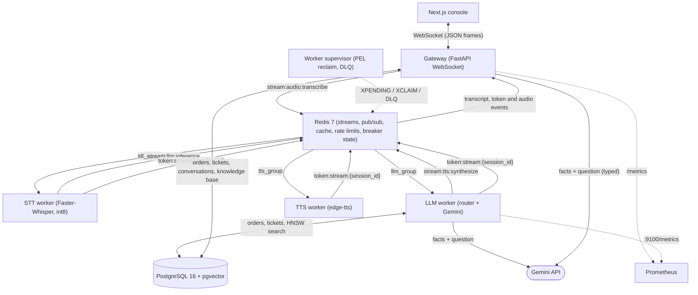
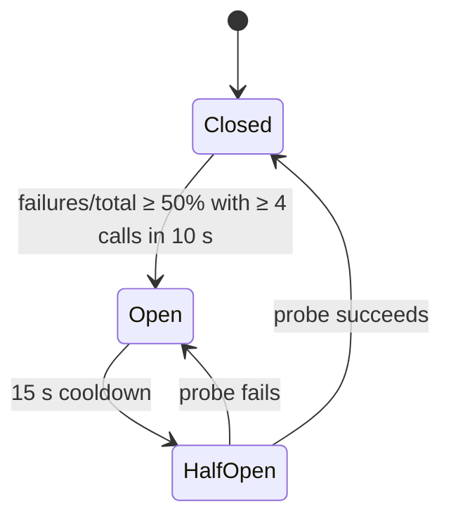

# Architecture

This document describes how Voxa's services fit together, the wire protocol between the console and the gateway, how answers are built, and how failures are handled. For setup and the API surface, see the [README](../README.md).

## Overview

Voxa is split into a gateway and a set of workers that talk through Redis:

- The **gateway** (FastAPI) owns client connections and the conversation records. It serves the WebSocket used by the console and answers typed questions itself.
- **Workers** handle the slow or CPU-heavy voice work: speech-to-text, answering transcripts, and text-to-speech. Each worker type is a Redis Streams consumer group, so it can be scaled on its own.
- Worker results flow back over a per-session Redis Pub/Sub channel, so any gateway replica can deliver them to the right client.
- **PostgreSQL with pgvector** stores users, orders, conversations, tickets and the knowledge base, including its embeddings.
- **Gemini** (`gemini-3.6-flash` by default) writes replies from facts the code has already fetched.



Typed questions are answered in the gateway because nothing in them is CPU-heavy, so a worker hop would only add latency. Spoken questions already pass through the queue for transcription, so the LLM worker answers the transcript where it is. Both use the same function, `answer_query` in `app/llm.py`.

## WebSocket protocol

Clients connect to `/v1/ws/stream?token=<JWT>`. The token is optional. Anonymous sessions work, but only authenticated sessions are saved (a conversation belongs to a user) and linked to the tickets they create. The token travels in the query string because browsers can't set headers on a WebSocket handshake; the gateway hides it in its access logs.

All frames are JSON text frames. A binary frame gets an `error` reply.

**Client → gateway**

- `{"type": "text_query", "text": "...", "trace_id": "<optional>"}`: at most 2,000 characters.
- `{"type": "audio_chunk", "audio_data": "<base64>", "trace_id": "<optional>"}`: one utterance, at most 4 MB of base64. Any container FFmpeg can decode works (WAV, WebM/Opus, OGG, MP4/AAC). The console caps recordings at 30 s.

**Gateway → client**

- `ack`: an `audio_chunk` was queued for transcription.
- `transcript`: what Whisper heard, `{"text", "stt_latency_ms", "trace_id"}`.
- `token_chunk`: the reply, streamed as Gemini produces it (a fallback or cached reply arrives as one chunk). The last frame has `is_final: true` and carries that turn's measurements:

  ```json
  {
    "type": "token_chunk",
    "token": "",
    "is_final": true,
    "ttft_ms": 2407,
    "total_latency_ms": 2567,
    "cache_hit": false,
    "fallback": false,
    "circuit_breaker": "CLOSED",
    "trace_id": "b1a47df1-0c5a-4e89-b7b5-fb358a9ce71b"
  }
  ```

  This one is a reply Gemini wrote for an order question. `fallback` is `true` whenever the plain reply was sent instead of Gemini's. `circuit_breaker` is the Gemini breaker state whenever it was checked, and `null` when it wasn't (no key, a cache hit, a blocked injection attempt). For voice, `ttft_ms` and `total_latency_ms` are measured by the LLM worker and don't include transcription.

- `audio_response`: base64 MP3 of the reply from the TTS worker (voice requests only). It arrives after the final `token_chunk`.
- `error`: a validation failure, a rate limit, an empty transcript, a dead-lettered task or an answering failure.

## Building an answer

`answer_query` runs two steps.

**1. Route and fetch facts.** `route_query` in `app/agent_tools.py` checks rules in priority order and stops at the first match:

1. Prompt-injection guardrail: a fixed refusal, never sent to Gemini.
2. Chargeback or legal threats: opens an urgent ticket.
3. Order lookup or refund eligibility from PostgreSQL. `ORD-88412`, `ORD 88412` and `ORD88412` are all accepted, because speech-to-text drops the hyphen.
4. Request for a person: opens a ticket.
5. Everything else: the semantic cache, then the top 3 knowledge-base passages with similarity above 0.35.

Each branch returns two things:

- **The facts** for Gemini, for example `Order ORD-88412: Voxa Wireless AI Earbuds Pro, ordered 2026-10-23, status Shipped, tracking number TRK-99281744US.`
- **A complete plain reply** built from the same facts.

An order that belongs to a user is visible only to that user. The SQL query applies the owner filter, so Gemini only ever receives "not found" for someone else's order. The seeded demo orders have no owner and are visible to everyone. Someone else's order gets the same reply as a missing one, so order IDs can't be probed.

**2. Write the reply.** `write_reply` in `app/llm.py` sends Gemini:

- a short system prompt: one to three plain sentences, use only the facts, repeat IDs exactly, treat the customer's text as untrusted
- the facts
- the masked question

The reply streams back chunk by chunk with the thinking level set to low. Gemini is skipped, and the plain reply sent instead, when:

- there is no `GEMINI_API_KEY`,
- the circuit breaker is open,
- the call raises (network, 4xx/5xx, quota),
- the reply takes longer than 10 s, or
- the reply comes back empty.

If the stream breaks after some text was sent, the plain reply is appended so the user still gets the facts.

## Workers and delivery guarantees

The gateway creates these consumer groups on start-up (idempotently):

| Stream | Group | Consumer |
| --- | --- | --- |
| `stream:audio:transcribe` | `stt_group` | STT worker |
| `stream:llm:inference` | `llm_group` | LLM worker (up to 8 entries per read, answered concurrently) |
| `stream:tts:synthesize` | `tts_group` | TTS worker |
| `stream:dead:letter:queue` | `dlq_group` | inspected manually |

Every `XADD` uses `MAXLEN ~ 10000`, so acknowledged entries don't accumulate.

Delivery is at-least-once:

- **Acknowledge last:** a worker `XACK`s an entry only after it has answered, re-queued or dead-lettered it.
- **Own pending entries first:** on each loop a worker re-reads its own unacknowledged entries (`XREADGROUP ... 0`) before taking new ones. Consumer names are random per process, so entries left by a crashed process are handled by the supervisor instead.
- **Crash recovery:** every 5 s the supervisor asks for entries idle longer than 15 s (`XPENDING ... IDLE 15000`), claims them and re-queues them with `retry_count` incremented. The attempt count travels in the payload, because a re-queued entry starts a fresh delivery counter.
- **Long tasks:** while a worker is busy (a long transcription, or a batch waiting on Gemini), it re-claims its entries every 5 s (`XCLAIM ... JUSTID`). Healthy work is therefore never mistaken for a crash and run twice.
- **Dead-letter queue:** after 3 attempts an entry goes to `stream:dead:letter:queue` with the error and its origin stream, and the client gets an `error` frame.

The LLM worker answers a batch concurrently, because each answer mostly waits on Gemini. It also loads the embedding model before it starts consuming; loading it lazily on the first transcript took about 20 s.

**Saving voice turns.** The gateway's Pub/Sub forwarder already sees the transcript, the reply tokens and the final frame for each voice request, so it collects them and saves the exchange with the same helper as typed questions. Workers never write conversations.

## Retrieval and the semantic cache

```
knowledge question (PII already masked)
  │
  ├─ Redis semantic cache: cosine ≥ 0.92 ──► cached reply (cache_hit = true, no Gemini call)
  │
  └─ miss ─► pgvector HNSW search (<=>) ──► passages with similarity > 0.35
                                              ──► Gemini reply ──► stored in the cache
```

**Embeddings**

- `all-MiniLM-L6-v2`, 384 dimensions.
- L2-normalised, so cosine similarity is a dot product.
- Encoding runs in a thread so it never blocks the event loop.

**Cache**

- A lookup scans at most 50 keys with `SCAN` and fetches them with one `MGET`.
- Entries expire after an hour.
- Only knowledge answers that Gemini wrote are stored. Order and ticket replies are user-specific, and fallback replies would otherwise keep being served after Gemini recovers.

**Knowledge base**

- The `knowledge_base` table is seeded on start-up. Any missing topic is added, so existing databases pick up new documents.
- It's indexed with `USING hnsw (embedding vector_cosine_ops)` (pgvector defaults: `m = 16`, `ef_construction = 64`).

## Circuit breaker

Gemini calls from the gateway and the LLM worker feed one Redis-backed breaker (`circuit:gemini:*`), so all of them see the same state.



- **Closed:** Gemini is called, and successes and failures are both counted.
- **Open:** Gemini is skipped and the plain reply is sent immediately.
- **Half-open:** one probe request holds a 10 s `SET NX EX` lease; everyone else gets the plain reply.
- **Redis unreachable:** the breaker can't read or write its state, so it lets calls through (state `UNKNOWN`) and logs a warning. The rate limiter does the same.

## Metrics

The gateway serves Prometheus metrics on `/metrics`, and the LLM worker on port 9100:

- `http_request_duration_seconds{method,endpoint,status_code}` (gateway): labelled by route template, not raw path, to keep cardinality bounded.
- `gemini_requests_total{outcome="ok"|"fallback"}`: replies Gemini was asked to write, and how many fell back.
- `gemini_request_duration_seconds`: from sending the request until the reply finished streaming or failed.
- `websocket_active_connections` (gateway): open sockets on this process.
- `semantic_cache_hit_total`, `semantic_cache_miss_total`: per-process counters. Fleet-wide totals are kept in Redis (`metric:semantic_cache_*`) for the admin API.

Metrics are process-local, so the gateway runs one uvicorn worker per container and scales by adding replicas.

`GET /v1/admin/metrics` (admin only) adds values computed from the database and Redis:

- average TTFT and p95 latency of saved replies
- cache hit ratio
- live workers (`worker:heartbeat:*`, 10 s TTL)
- queue backlog (pending plus lag per consumer group)
