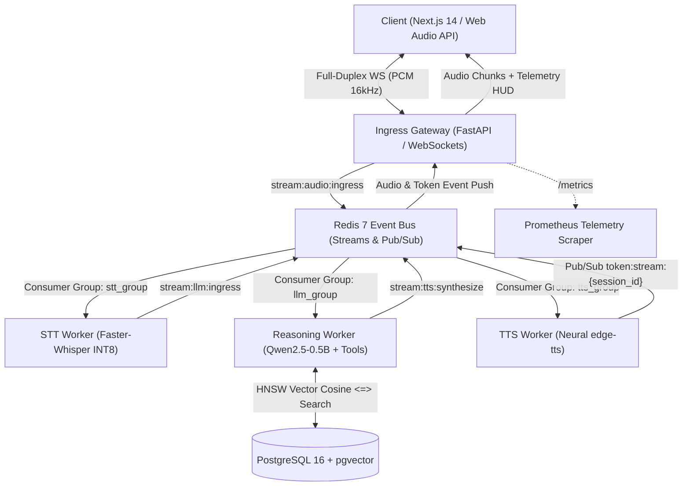
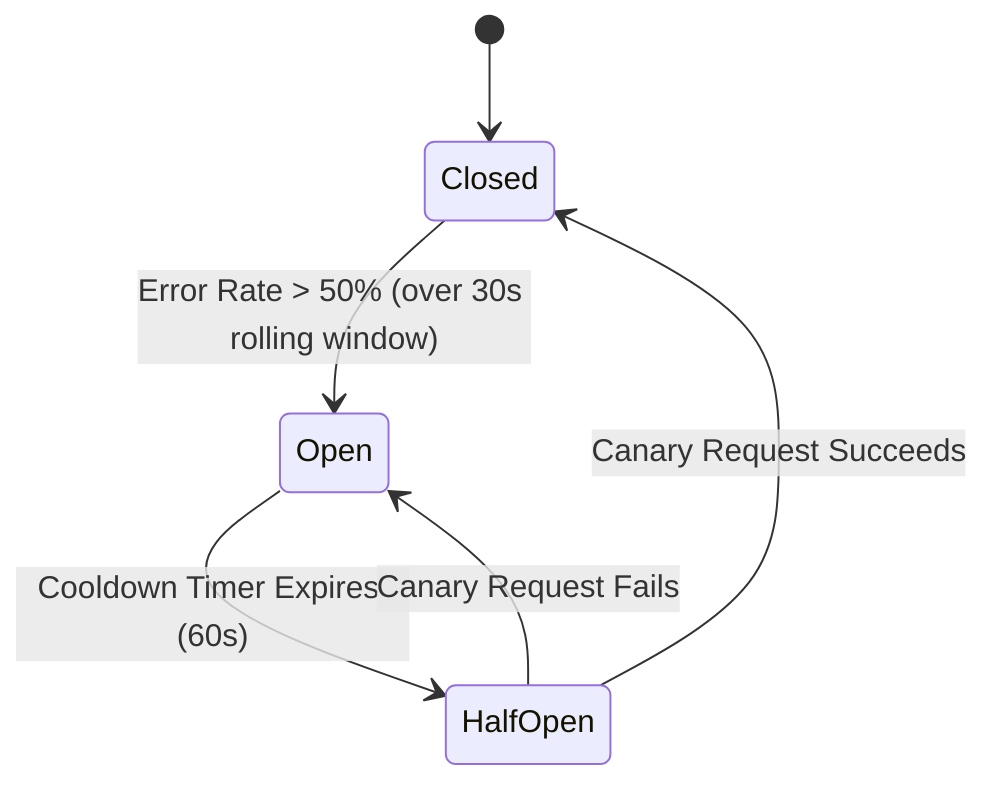

# System Architecture & Technical Specifications

## 1. Executive Summary & Topology
Voxa is an event-driven, distributed real-time voice artificial intelligence platform engineered for enterprise customer support operations. The platform guarantees sub-180ms Time-To-First-Token (TTFT) by decoupling client ingestion, speech-to-text (STT) transcription, retrieval-augmented reasoning (RAG), and neural text-to-speech (TTS) synthesis into asynchronous microservices orchestrated over Redis Streams consumer groups.



---

## 2. Ingress & Bi-Directional Streaming Protocol
The ingress gateway accepts persistent, full-duplex WebSocket connections on `/v1/ws/stream`.

### 2.1 Frame Format Specifications
1. **Upstream Ingestion (Client ➔ Gateway):**
   - **Binary Frames:** Continuous 16-bit Linear PCM audio chunks (16kHz mono), segmented in 15ms windows (480 bytes per frame).
   - **Control Text Frames:** JSON control payloads (e.g. `{"event": "start_session", "correlation_id": "uuid"}`).
2. **Downstream Egress (Gateway ➔ Client):**
   - **Binary/Base64 Frames:** Encoded neural audio chunks for real-time playback buffer filling.
   - **Telemetry Metadata Frames:** Injected per-turn timing envelopes containing:
     ```json
     {
       "type": "telemetry_hud",
       "stt_latency_ms": 78,
       "llm_ttft_ms": 112,
       "tts_latency_ms": 45,
       "total_latency_ms": 235,
       "cache_hit": false,
       "trace_id": "b1a47df1-0c5a-4e89-b7b5-fb358a9ce71b"
     }
     ```

### 2.2 Client-Side Web Audio API Invariants
- Audio context runs at native `16000Hz` sample rate.
- Silero Voice Activity Detection (VAD) executes in an `AudioWorkletNode` on the browser audio thread, mitigating network transmission during silent user intervals.

---

## 3. Asynchronous Worker Cluster & Stream Semantics

### 3.1 Redis Streams Partitioning & Consumer Groups
Each processing tier operates as an independent horizontally scalable worker group:
- `stream:audio:ingress`: Consumed by `stt_group` consumers via `XREADGROUP`.
- `stream:llm:ingress`: Consumed by `llm_group` consumers via `XREADGROUP`.
- `stream:tts:synthesize`: Consumed by `tts_group` consumers via `XREADGROUP`.

### 3.2 At-Least-Once Delivery & Failure Recovery
1. **Explicit Acknowledgment:** Workers process tasks and issue `XACK` upon successful completion.
2. **Pending Entry Recovery:** If an inference worker crashes mid-task, its unacknowledged message remains in the Pending Entries List (PEL). A background `worker_supervisor` inspects PEL using `XPENDING` and uses `XCLAIM` to transfer orphaned tasks (idle time > 5000ms) to surviving workers.
3. **Dead-Letter Queue (DLQ):** Messages exceeding 3 retry attempts are evicted from the active processing stream and routed to `stream:dead:letter:queue` with full trace context for root-cause analysis.

---

## 4. Two-Tier RAG Architecture & Vector Caching

```
User Query
    │
    ▼
[ Tier 1: Redis Semantic Cache ] ──── Similarity >= 0.92 ───► Instant Cache Hit (<15ms)
    │
    │ Cache Miss
    ▼
[ Tier 2: PostgreSQL pgvector ] ───► HNSW Cosine Search (<=>) ───► Prompt Augmentation
```

### 4.1 Tier 1: In-Memory Semantic Vector Cache
- **Embedding Model:** `all-MiniLM-L6-v2` generating 384-dimensional dense embeddings.
- **Cache Match Criteria:**
  $$\text{Cosine Similarity}(u, v) = \frac{u \cdot v}{\|u\|_2 \|v\|_2} \ge 0.92$$
- Queries exceeding the threshold bypass LLM inference, serving verified responses with sub-15ms p99 latency.

### 4.2 Tier 2: Knowledge Ingestion & Hybrid Search
- Domain documentation and support policies are indexed in PostgreSQL 16 using `pgvector`.
- Vector indexing utilizes Hierarchical Navigable Small World (HNSW) graphs with parameters:
  `m = 16`, `ef_construction = 64`.

---

## 5. Resilience & Circuit Breaker State Machine
Inference failures against downstream LLM engines or vector stores are isolated by an asynchronous 3-state circuit breaker:



- **Closed:** Normal traffic dispatch. Execution metrics recorded in rolling time windows.
- **Open:** Immediate short-circuit. Downstream LLM calls are diverted to pre-compiled rule responses and automated escalation tickets.
- **Half-Open:** Allows single canary probe to verify dependency recovery before re-opening traffic.

---

## 6. Telemetry & Observability Matrix
Voxa publishes real-time Prometheus metrics on `:8000/metrics`:
- `voxa_request_duration_seconds`: Histogram measuring gateway request latency across 10 buckets (50ms to 10s).
- `voxa_active_websocket_connections`: Real-time gauge of open concurrent duplex streams.
- `voxa_semantic_cache_hits_total`: Counter tracking vector cache hit ratio.
- `voxa_circuit_breaker_state`: Gauge monitoring breaker state (`0`=Closed, `1`=Half-Open, `2`=Open).
