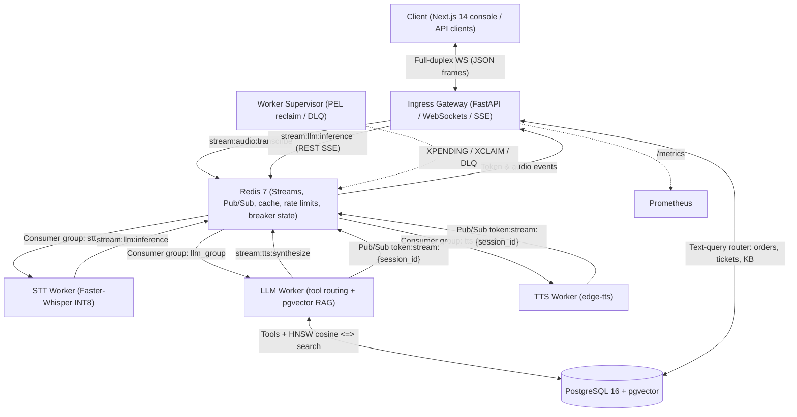
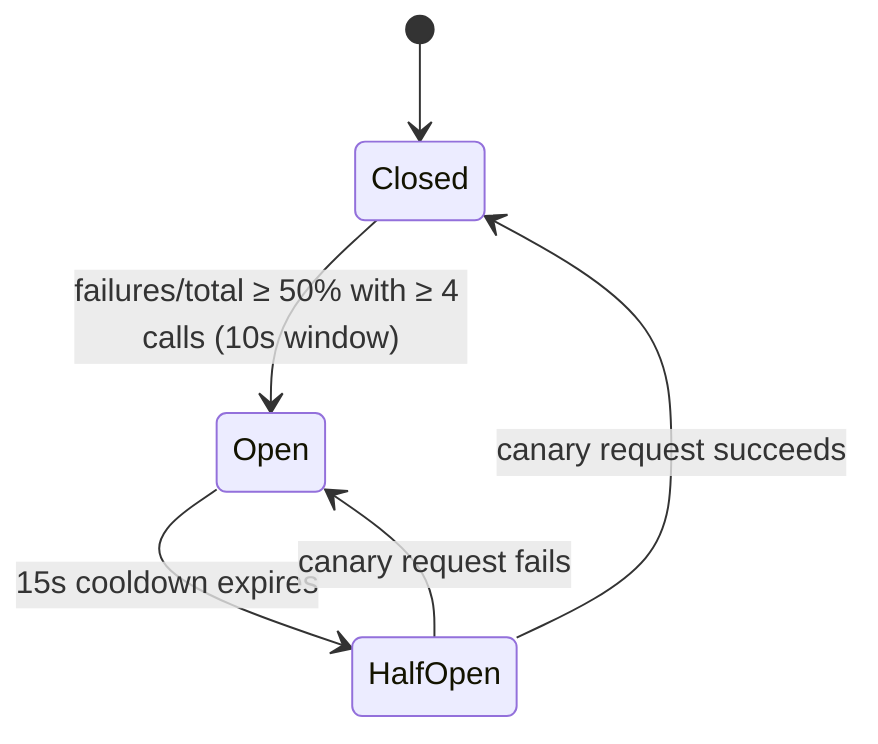

# System Architecture & Technical Specifications

## 1. Executive Summary & Topology
Voxa is an event-driven, distributed customer-support platform. Client ingestion, speech-to-text (STT), answer generation (tool routing + retrieval-augmented answers), and text-to-speech (TTS) are decoupled into asynchronous services orchestrated over Redis Streams consumer groups, with per-session Redis Pub/Sub channels carrying results back to whichever gateway replica owns the client connection. The latency target is a sub-180ms time-to-first-token (TTFT); every response reports its measured TTFT.



---

## 2. Ingress & Bi-Directional Streaming Protocol
The gateway accepts persistent, full-duplex WebSocket connections on `/v1/ws/stream?token=<JWT>`. The token is optional; only authenticated sessions are persisted (a conversation belongs to a user) and attributed on escalation tickets.

### 2.1 Frame Format Specifications
All frames are JSON **text** frames (binary frames are rejected with an `error` frame).

1. **Upstream (Client ➔ Gateway):**
   - `{"type": "text_query", "text": "...", "trace_id": "<optional>"}` (max 2,000 characters)
   - `{"type": "audio_chunk", "audio_data": "<base64 audio>", "trace_id": "<optional>"}` (one utterance, max 4 MB base64; any FFmpeg-decodable container such as WAV or WebM/Opus)
2. **Downstream (Gateway ➔ Client):**
   - `token_chunk`: streamed answer words; the last frame has `is_final: true` and carries the turn's telemetry:
     ```json
     {
       "type": "token_chunk",
       "token": "",
       "is_final": true,
       "ttft_ms": 6,
       "total_latency_ms": 412,
       "cache_hit": false,
       "circuit_breaker": "CLOSED",
       "trace_id": "b1a47df1-0c5a-4e89-b7b5-fb358a9ce71b"
     }
     ```
   - `ack`: an `audio_chunk` was queued for transcription.
   - `audio_response`: base64 MP3 from the TTS worker (voice path only).
   - `error`: validation failures, rate limiting, empty transcripts, dead-lettered tasks.

### 2.2 Text-Query Routing (gateway, in-process)
Text queries are answered without a worker hop by a priority-ordered router: injection guardrail → chargeback/legal escalation (creates a ticket) → B2B, customs, multipoint, water-damage, price-match, delivery and buying-advice policies → order lookup / refund eligibility (PostgreSQL) → human escalation (ticket) → greeting → semantic cache → pgvector knowledge-base answer. Only the final generic branch reads or writes the semantic cache.

### 2.3 Client-Side Audio
The bundled console captures speech with the browser's Web Speech API and sends the transcript as a `text_query`; a Web Audio `AnalyserNode` drives the voice-orb animation. The server-side `audio_chunk` → Faster-Whisper path is available to API clients.

---

## 3. Asynchronous Worker Cluster & Stream Semantics

### 3.1 Redis Streams & Consumer Groups
Each processing tier is an independently scalable consumer group (created idempotently by the gateway on startup):
- `stream:audio:transcribe`: consumed by `stt_group`.
- `stream:llm:inference`: consumed by `llm_group` (the LLM worker reads up to 8 entries per batch, blocking 15ms).
- `stream:tts:synthesize`: consumed by `tts_group`.
- `stream:dead:letter:queue`: quarantined tasks for inspection.

Every `XADD` uses `MAXLEN ~ 10000` so acknowledged history does not grow without bound.

### 3.2 At-Least-Once Delivery & Failure Recovery
1. **Explicit acknowledgment:** workers `XACK` only after a task is fully handled (answered, re-enqueued or dead-lettered).
2. **Own-PEL replay:** on every loop a worker first re-reads its own un-acknowledged entries (`XREADGROUP ... 0`) before taking new ones. Consumer names are random per process, so entries left behind by a crashed process are recovered by the supervisor (next step).
3. **Crash recovery:** `worker_supervisor` polls `XPENDING` every 5s; entries idle for more than 15,000ms belong to a dead consumer and are `XCLAIM`ed and re-appended with `retry_count` incremented. Because a re-appended entry starts a fresh delivery counter, the attempt count travels in the payload.
4. **Dead-Letter Queue:** a task that has used 3 attempts is written to `stream:dead:letter:queue` with its error/reason and origin stream, and the client is sent an `error` frame.

---

## 4. Two-Tier RAG Architecture & Vector Caching

```
Generic user question (after PII masking)
    │
    ▼
[ Tier 1: Redis Semantic Cache ] ──── cosine ≥ 0.92 ───► cached answer (cache_hit = true)
    │
    │ Cache miss
    ▼
[ Tier 2: PostgreSQL pgvector ] ───► HNSW cosine search (<=>) ───► best passage if similarity > 0.35,
                                                                  else a generic policy answer
```

### 4.1 Tier 1: Semantic Vector Cache
- **Embedding model:** `all-MiniLM-L6-v2`, 384-dimensional, L2-normalised, so cosine similarity is a dot product. Inference runs in a worker thread to keep the event loop free.
- **Match criteria:** $$\text{Cosine Similarity}(u, v) = u \cdot v \ge 0.92$$
- **Lookup cost:** at most 50 keys via incremental `SCAN` plus one `MGET`; entries expire after 1 hour.
- **Scope:** only user-independent policy answers are cached; order data and tickets never are.

### 4.2 Tier 2: Knowledge Retrieval
- Support policies are stored with embeddings in `knowledge_base` (seeded on startup).
- Index: `CREATE INDEX ... USING hnsw (embedding vector_cosine_ops)` with pgvector defaults (`m = 16`, `ef_construction = 64`).

---

## 5. Resilience & Circuit Breaker State Machine
Failures of the answering path (router exceptions on the WebSocket path, LLM-worker timeouts on the SSE path) feed one Redis-backed breaker (`circuit:ai_worker:*`) shared by all gateway replicas:



- **Closed:** normal traffic; successes and failures are both counted.
- **Open:** immediate fallback message; no downstream calls.
- **Half-Open:** exactly one canary request holds a 10s `SET NX EX` probe lease; concurrent requests get the fallback.

---

## 6. Telemetry & Observability Matrix
The gateway exposes Prometheus metrics on `/metrics` (container port 8000, published as 8088):
- `http_request_duration_seconds{method,endpoint,status_code}`: histogram labelled by **route template** (bounded cardinality).
- `llm_time_to_first_token_seconds`: TTFT of SSE responses relayed from the LLM worker.
- `websocket_active_connections`: open WebSockets on this process.
- `semantic_cache_hit_total` / `semantic_cache_miss_total`: per-process cache counters (fleet-wide totals are also kept in Redis keys `metric:semantic_cache_*` for the admin API).

Metrics are process-local, so the gateway runs one uvicorn worker per container and scales by replicas. `GET /v1/admin/metrics` (admin only) adds database- and Redis-derived values: average TTFT, p95 latency, cache hit ratio, live worker heartbeats (`worker:heartbeat:*`, 10s TTL) and queue backlog (pending + lag per consumer group).
